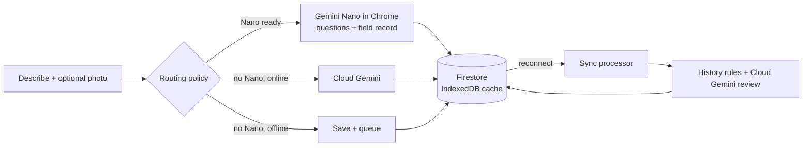

# Munda

**An offline-first farm assistant for smallholder farmers, starting with maize scouting. Built on Firebase AI Logic hybrid inference.**

*Munda* means "field" in Shona. Munda helps a farmer or extension officer with no signal turn "my maize leaves are going yellow" into a careful, structured field record: **possible causes with visible uncertainty, the evidence for and against each, and what to check next.** When the device reconnects, the record syncs and Munda reviews it against the plot's history and the rest of the farm.

> Munda does not diagnose. It helps farmers observe carefully, record consistently and decide what to check next. Serious or uncertain cases are pointed to an extension officer.

**Platforms:** **Android** (Kotlin, Jetpack Compose) is the farmer's app. The **web app** (installable PWA) is the extension officer's tool, with the live group view and area map, and the way in for anyone on an iPhone or a computer. Both use Firebase AI Logic hybrid inference, with Gemini Nano on-device where the device supports it and cloud Gemini otherwise. They share one Firestore backend, one set of security rules, one crop guide and one set of translations, so a record made on a phone opens on the web, and the reverse. See [ADR 0006](docs/adr/0006-two-platforms.md).

## Try it

- **Web app:** https://app-munda.web.app (Chrome on a laptop or Android phone; Safari on iPhone). Tap *See an example* for a sample result without setting anything up.
- **Android app:** download [`munda.apk`](https://github.com/Tatendamarimo/munda/releases/latest/download/munda.apk) from the latest release and open it on the phone (Android 8 or newer; allow installing from your browser when asked).
- **Video:** *link added on submission.*
- **Offline AI on a laptop:** in Chrome, Munda can run Gemini Nano on the device. If the status says *Cloud AI only*, the device or browser doesn't support on-device AI yet, and Munda uses cloud Gemini.

---

## The problem

Smallholder maize farmers lose yield to problems they notice too late or misread. Yellowing, for example, can mean nitrogen deficiency, waterlogging, sulfur deficiency, a virus or striga, and each needs a different response. Extension officers are scarce, and farms often have no signal. Cloud-only AI tools fail exactly where they're needed, and tools that confidently "diagnose" from one description can lead to money spent on the wrong inputs.

## What Munda does

1. **Describe.** Type or dictate what you see, pick the plot and crop stage, and optionally add a leaf photo.
2. **Answer a few questions.** Munda always asks the three questions agronomists ask first: *how much of the plot is affected, recent rainfall, and when it started*. Gemini Nano then asks up to two more questions chosen to **tell the likely causes apart** (for example, "Are the yellow leaves at the bottom or the top of the plant?").
3. **See possible causes.** Gemini Nano writes a structured field record: up to three possible causes, each with a likelihood meter, *fits what you saw*, *doesn't fit / still unknown*, and *check next*. It's saved instantly, offline.
4. **History review on reconnect.** The record syncs to Firestore and cloud Gemini reviews it against the plot's past records and other plots. It flags recurring, spreading, worsening or rain-linked problems, revises likelihoods, and lists the next checks in priority order.

Every record shows **where its AI actually ran** ("On this device" / "Cloud AI" / "Waiting for signal"), taken from the SDK's `inferenceSource`, never guessed.

## Easy for any farmer, in their language

- **Picture answers.** One question per screen, answered by tapping drawings (patches, low wet spots, heavy rain, this week). Typing is optional; a photo alone is enough to start.
- **Check before buying anything.** Every result leads with one field check to do before spending money on inputs.
- **Seven languages:** English and chiShona, plus isiNdebele, Kiswahili, Français, Português and Español (marked *beta* until a native speaker reviews them). Screens, the maize guide and its field checks are all translated. Adding a language is one dictionary file and one guide file.
- **Offline in any language.** Gemini Nano runs in English here, so the app shows cause names and field checks from the human-written guide in the farmer's language, with the model's own English wording under *Details*. In cloud mode the model writes in the farmer's language directly.
- **Search in any language.** On-device retrieval matches keywords from every translated guide (accent-insensitive), so "mashizha ari kuita yellow" or "hojas amarillas" find the right entries.
- **Read aloud** on questions, results and guide pages, where the device has a voice for the language.
- **Plots and history at a glance:** a home screen with the farm summary and latest alert, a timeline per plot (affected area against heavy rain), and the cloud review's patterns and next steps.
- **Local details stay on the phone:** name, area, extension officer's number, planting dates and an optional rain outlook (Open-Meteo) are kept in local storage, never in Firestore.

## One app, hybrid by design

| Device | What happens |
|---|---|
| Laptop or desktop with **Chrome** (e.g. the extension officer's or cooperative's MacBook) | Gemini Nano runs questions and records **on the device, offline**, including from a leaf photo |
| Any phone browser (e.g. a farmer's iPhone) | Same app; AI runs in the **cloud** when connected; offline, observations are **saved and finished on reconnect** |

## How it uses Firebase AI Logic

| Step | Where it runs | Why |
|---|---|---|
| Follow-up questions | **On-device** (Gemini Nano, `PREFER_ON_DEVICE`), cloud fallback | Must work with no signal; private; free |
| Field record (possible causes) | **On-device** (`PREFER_ON_DEVICE`, JSON via `responseConstraint`, optional photo), cloud fallback | The answer arrives on the spot |
| Long notes | **Cloud** (`ONLY_IN_CLOUD`) | Too large for Nano's context, so never silently truncated |
| History review | **Cloud only** | Needs Firestore history + the full guide; not time-critical |
| No model + no signal | **Queued** in Firestore, finished on reconnect | Nothing is lost |

On-device inference is single-turn, so the "conversation" is two single-turn calls (questions, then record) rather than chat. One JSON Schema per output drives both paths: `onDeviceParams.promptOptions.responseConstraint` for Nano and `responseJsonSchema` for cloud Gemini.

Key code ([`web/src`](web/src)):
- [`ai/mundaAi.ts`](web/src/ai/mundaAi.ts): hybrid models, `initializeDeviceModel`, routing, backoff, `inferenceSource`
- [`domain/routing.ts`](web/src/domain/routing.ts): decides on-device / cloud / queue *before* the farmer taps, and shows why
- [`ai/reviewer.ts`](web/src/ai/reviewer.ts): cloud history review on top of deterministic rules
- [`sync/syncProcessor.ts`](web/src/sync/syncProcessor.ts): finishes queued records and runs reviews when online (Web Locks, backoff)



Other Firebase products: **App Check** (reCAPTCHA Enterprise; debug token locally), **Authentication** (anonymous, with an `orgId` custom-claim seam for cooperatives), **Firestore** (persistent offline cache, security rules tested in the emulator), **Remote Config** (model names, on-device size limit, history thresholds, feature flags), **Hosting** (the judged URL).

## Uncertainty, by design

The rules are enforced in code ([`domain/parser.ts`](web/src/domain/parser.ts)), not just requested in a prompt:

- A cause can only be **Likely** if at least two observations support it.
- Only **one** cause can be Likely at a time.
- Every cause must say **what to check next**; if the model omits it, the guide's field check is used.
- Causes can only reference guide entries that were actually sent; history patterns can only cite records that exist.
- Likelihood is shown as words *and* a meter, and each record says what would change the assessment.

## Grounding: the maize guide

Munda reasons from a compact [maize guide](shared/guides/maize.json) of 14 common problems (nutrient deficiencies, waterlogging, drought stress, fall armyworm, stalk borer, maize streak virus, MLN, leaf diseases, striga), summarised from widely published extension guidance. Each entry has its signs, how to tell it apart from look-alikes, and a field check. One JSON file feeds both clients (a parity test keeps Android in sync).

Because Nano's context is small, **retrieval happens on the device**: keyword matching with context boosts (e.g. heavy rain plus low spots favours waterlogging) picks the 4–5 most relevant entries for the prompt. The cloud review sees the whole guide. No model training is involved.

## Built to grow

Crops plug in as a `SymptomGuide` plus a guide file; prompts, retrieval, parsing and history rules are crop-agnostic, and history only compares like with like. Livestock is planned as a separate subject type with stricter vet-referral rules ([ADR 0004](docs/adr/0004-multi-crop-and-livestock.md)).

## Privacy

- With Gemini Nano available, questions and records are generated on the device.
- Photos are used for assessment only and are **never uploaded or stored**.
- Data syncs only to the farm group's Firestore workspace: author-only writes, org-scoped reads, immutable observations, no client deletes.

## Setup (web)

**Requirements:** Node 24 (`web/.nvmrc`), a Firebase project, and Chrome on a desktop/laptop for on-device AI (macOS 13+, Windows 10/11 or Linux, ~22 GB free disk). Any modern browser works in cloud mode.

1. **Firebase console**
   - Create a project; add a **Web app**; copy its config.
   - **AI Services → AI Logic → Get started** (Gemini Developer API).
   - **Authentication → Sign-in method → Anonymous → Enable**.
   - **Firestore → Create database**.
   - **App Check → Apps → your web app → reCAPTCHA Enterprise**: create a key and add your hosting domains (`<project>.web.app`, `<project>.firebaseapp.com`). Don't add `localhost`.
2. **Config:** `web/.env` already points at the `app-munda` project. To use your own project, `cp web/.env.example web/.env.local` and fill in its values (they override `.env`).
3. **Deploy rules and indexes:** `firebase deploy --only firestore --project <project-id>`
4. **Run locally:** `cd web && npm install && npm run dev`. Add `?demo` to the URL to see every screen with a sample farm (development builds only). Open the printed URL in Chrome, copy the **App Check debug token** from the browser console, and register it under **App Check → Apps → Manage debug tokens**.
5. **Enable on-device AI in Chrome** (if not already on): open `chrome://flags`, enable **Prompt API for Gemini Nano** and **Prompt API for Gemini Nano with Multimodal Input**, restart Chrome. Check the model under `chrome://on-device-internals`.
6. In Munda, tap **Set up this device**, then **Download offline AI**, and wait for **Works offline**. Turn Wi-Fi off and record an observation.
7. **Deploy for judging:** `cd web && npm run build && cd .. && firebase deploy --only hosting --project <project-id>`

### Android

**Requirements:** Android Studio (current stable), JDK 17. On a Mac, Android's emulator needs Apple Silicon for usable speed. The emulator has no on-device model, so it runs in cloud mode; offline AI on Android needs a supported phone.

1. In the same Firebase project, **add an Android app** with package `app.munda`. Download `google-services.json` to `android/app/` (it's git-ignored).
2. **App Check → your Android app → Play Integrity.** For the emulator, run the debug build, copy the debug token from Logcat (`DebugAppCheckProvider`) and register it under **Manage debug tokens**.
3. Open `android/` in Android Studio and run the `app` configuration, or `cd android && ./gradlew installDebug`.

## Tests

```bash
cd web && npm test                         # routing, retrieval eval (English + 7-language scenarios), parser/uncertainty rules, history rules, i18n, plots
cd firebase/rules-test && npm install && npm test   # Firestore security rules in the emulator
cd android && ./gradlew testDebugUnitTest  # Android domain tests + shared-guide parity
```

End-to-end smoke test (real UI in Chrome + Auth/Firestore emulators + security rules + a fake on-device model):

```bash
cd web
npm run e2e:emulators   # terminal 1 (needs Java; install firebase/rules-test deps first)
npm run e2e:serve       # terminal 2 (uses the fake config in .env.e2e)
npm run e2e             # terminal 3 (set CHROME=/path/to/chrome if not /usr/bin/google-chrome)
```

Flow regressions (no emulators; dev server + fake on-device model): `cd web && npm run dev`, then `node e2e/flow-regressions.mjs`.

See [`docs/eval/scenarios.md`](docs/eval/scenarios.md) for the evaluation scenarios and [`docs/eval/test-images.md`](docs/eval/test-images.md) for openly licensed maize image datasets.

## Project structure

```
web/                 PWA (React + TypeScript + Vite)
  src/domain/        Pure TS: models, guide + retrieval, routing, parser (uncertainty rules), history rules
  src/ai/            Hybrid AI (on-device + cloud), prompts, JSON schemas, cloud reviewer
  src/data/          Firebase bootstrap, Firestore repository, session, Remote Config
  src/sync/          Finishes queued work when online
  src/i18n/          Dictionaries for 7 languages (typed against English)
  src/ui/            Screens (Home, Plots, Guide, Me, observation flow)
android/             Android client (Kotlin/Compose), same design, data and rules
shared/guides/       Crop guides: single source of truth for all clients
  i18n/              Guide translations and keywords per language
firebase/            Firestore rules, indexes, rules tests
docs/                ADRs, eval scenarios, demo script
```

## Limitations and roadmap

- Gemini Nano in Chrome runs on desktop/laptop only; phones use cloud mode with offline queueing.
- Dictation in desktop Chrome uses a cloud speech service; typing always works offline.
- On-device AI writes in English; the app translates guide-backed names and checks, and cloud mode writes in the farmer's language. Beta languages need native-speaker review.
- Maize only for now; other crops and livestock are planned ([ADR 0004](docs/adr/0004-multi-crop-and-livestock.md)).
- Activation needs one online session (sign-in and model download); after that Munda works offline.

## License

[Apache 2.0](LICENSE)
