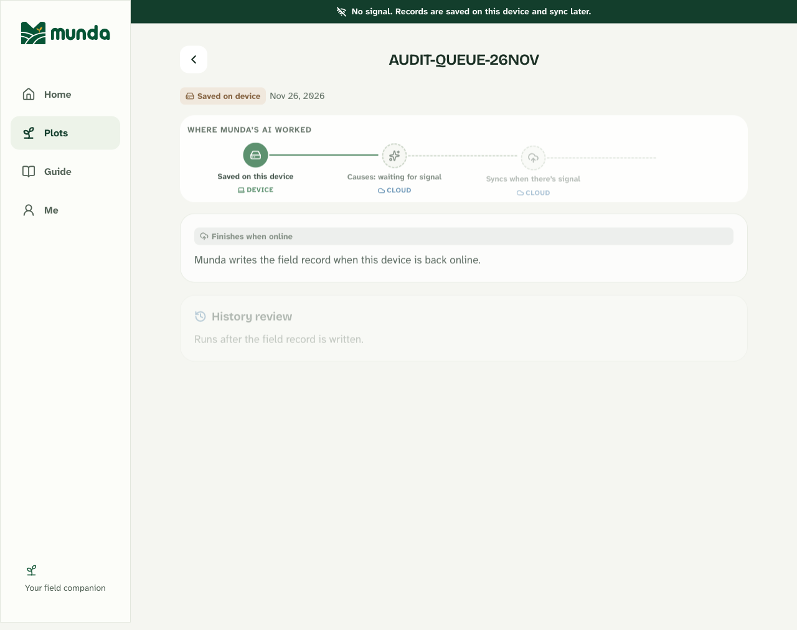
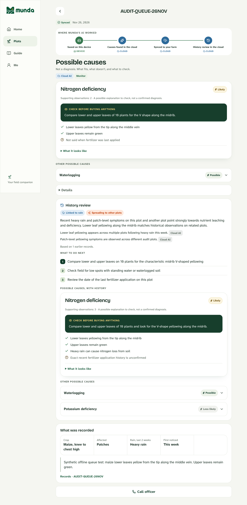
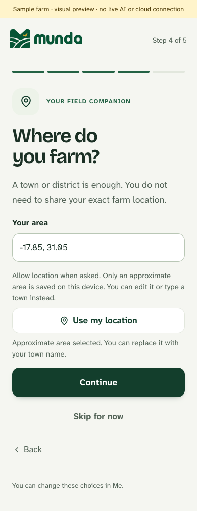

# Live validation — 26 November 2026

The cloud and queue tests ran against https://app-munda.web.app/ in a separate Chrome profile, using a guest identity and clearly labelled synthetic maize observations. No model response was mocked for these tests. This demonstrates software behavior, not agronomic accuracy or real farmer outcomes.

## Results

- **Real cloud inference passed.** Follow-up questions and a full structured report completed through Firebase AI Logic. Observed HTTP 200 responses from `gemini-3.7-flash` and `gemini-3.5-flash-lite`; the generated record displayed Cloud AI. The result varied between runs, as expected.
- **Offline save and reconnect passed.** With networking disabled for the test browser using Playwright's offline mode, a new observation on `AUDIT-QUEUE-26NOV` saved locally and showed Waiting for signal. After re-enabling networking, a real cloud call generated its report. A later readback confirmed Synced and a completed history review with model-produced findings labelled Cloud AI, plus updated possible causes. Browser network isolation was used; the computer's Wi-Fi was not switched off.
- **Genuine offline inference is still unverified.** The isolated Chrome 158 profile exposes the real Prompt API but reports both text and text/image model availability as `unavailable`. There was no physical Android device connected. This does not establish that the Mac cannot run a model: it has 32 GiB RAM, six physical cores and an existing model folder in the normal Chrome installation. Do not substitute the successful offline queue test for local inference evidence.
- **Location UI passed with simulated GPS.** Explicit button selection in setup produced an editable area rounded to a roughly 5 km grid; exact GPS precision was discarded. Permission-denial and manual-edit behavior are covered by unit tests. No actual personal location was obtained during validation.
- **Guide playback sequencing passed using a mock speech engine.** Seven sequential passages for ear/cob rot included prevention, source titles and the final safety note. The mock voice validates text and sequencing, not real audio intelligibility or agronomic correctness. All substantive guide sections are included even when the selected language has only partial guide translations; existing English fallback content stays English.
- **Automated checks:** 173 web tests; production TypeScript/Vite build; Android compile and 72 unit tests passed.

## Evidence

## Remaining demonstration requirement

On a supported real device with the required local model downloaded, turn off that device's connection and create a fresh check that actually reports SDK origin ON_DEVICE. Then reconnect and show sync/review. Capture the hardware/model readiness and the full run; never use development preview data or a fake LanguageModel for this proof.
